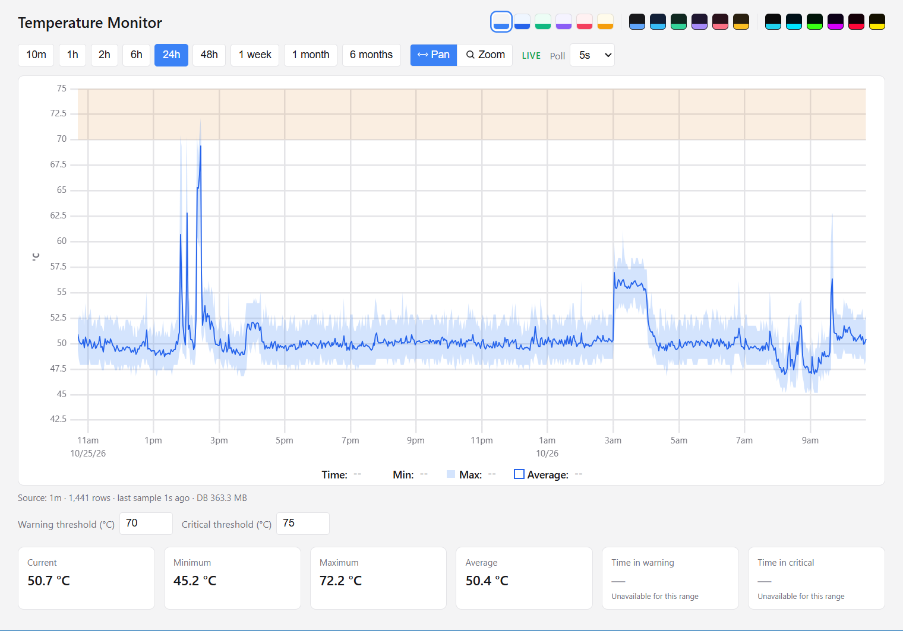
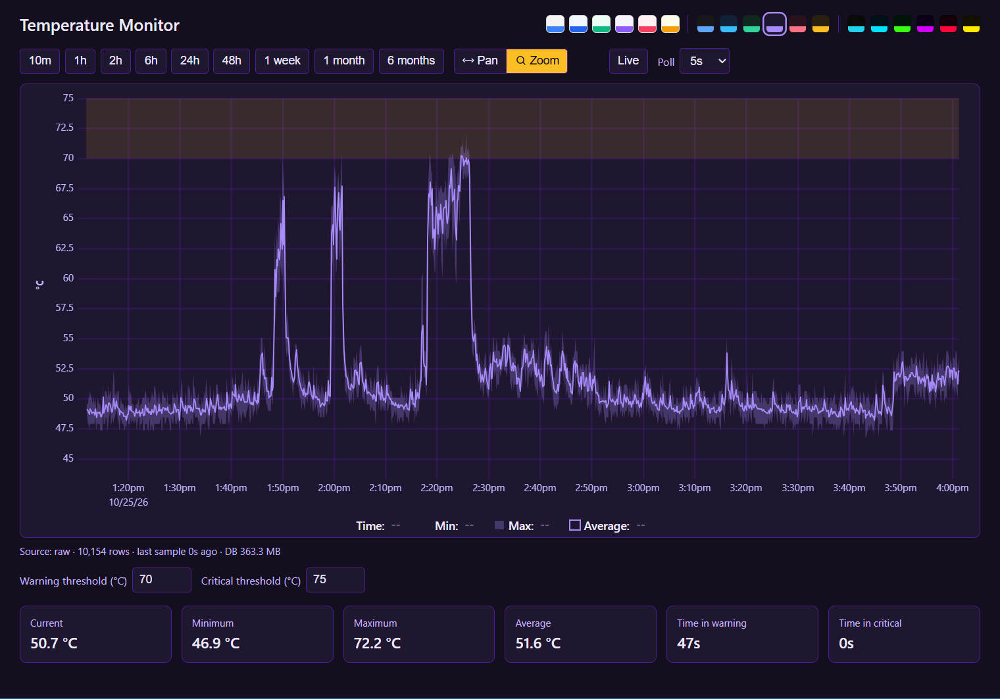
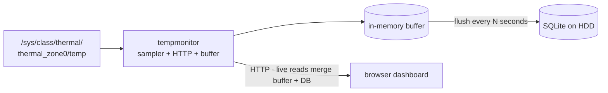

# Temperature Monitor

Lightweight Go service that samples CPU temperature on Linux, buffers samples in memory, periodically persists them to SQLite on disk, and serves a live chart UI with min/max/mean bands, warning/critical thresholds, and multi-range history.

Designed for always-on boards (e.g. Raspberry PI): one process samples at 1 Hz, keeps an in-memory buffer to reduce HDD wear, and flushes to SQLite on a configurable interval. Long chart ranges stay fast via precomputed 1m / 1h / 1d rollups.

## Screenshots

### Light theme



### Dark theme



## Features

- Live temperature chart ([uPlot](https://github.com/leeoniya/uPlot)) with pan/zoom and range presets (10m → 1 month)
- Configurable warning and critical thresholds (°C)
- Stats: current, min, max, mean, time in warning / critical
- In-memory sample buffer with configurable flush interval (minimize HDD writes)
- SQLite storage with WAL; continuous rollups for efficient long-range queries
- Multiple UI themes (persisted in the browser)
- Cross-compile friendly (`build.sh` for windows/amd64 and linux/arm64)

## Architecture



## Requirements

- [Go](https://go.dev/dl/) 1.25+ (see `go.mod`)
- **Sampling:** Linux with `/sys/class/thermal/thermal_zone0/temp` (millidegrees Celsius)
- **UI / API:** browser with network access to the service
- **Runtime (approx.):** ~1 CPU core; ~**100 MB** RAM for the process 
  - Steady state is near-idle (&lt;1–2% of one core, roughly 25–50 MB)
  - Spikes during large raw-range queries or first-start rollup backfill
- **Storage:** ~1GB for 1 year continuous measurement, ~85MB / month

## Quick start

```bash
export DATABASE_PATH="./temperature.db"
export PORT="5500"
export FLUSH_INTERVAL_SEC=3600   # optional; default 1 (flush every second)
go run ./cmd/tempmonitor
```

Open [http://localhost:5500](http://localhost:5500).

Or:

```bash
./debug-run.sh
```

On first start with existing raw data, rollups are backfilled in the background. HTTP comes up immediately; sampling starts after backfill finishes. Until rollups are ready, queries use raw samples.

### Cross-compile

```bash
./build.sh
# 1) windows/amd64  → build/windows-amd64/tempmonitor.exe
# 2) linux/arm64    → build/linux-arm64/tempmonitor
```

Copy the binary together with `index.html`, `themes.css`, and `themes.js` (same working directory).

## Configuration

| Variable             | Required | Default | Description                                                                                                                                                                                  |
| -------------------- | -------- | ------- | -------------------------------------------------------------------------------------------------------------------------------------------------------------------------------------------- |
| `DATABASE_PATH`      | yes      | —       | SQLite file path (parent dirs are created if needed)                                                                                                                                         |
| `PORT`               | yes      | —       | HTTP listen port                                                                                                                                                                             |
| `FLUSH_INTERVAL_SEC` | no       | `1`     | How often to flush the RAM buffer to the DB (seconds). Example: `3600` = one write batch per hour. Crash may lose up to one interval of unflushed samples. Graceful shutdown always flushes. |

## HTTP API

Base URL: `http://<host>:<PORT>`

### `GET /api/v3/temperature`

Chart series + stats + response meta.

| Parameter                               | Required | Description                              |
| --------------------------------------- | -------- | ---------------------------------------- |
| `from`, `to`                            | yes      | Unix timestamps (seconds)                |
| `downsampleTo`                          | yes      | Target number of buckets (≈ chart width) |
| `warningThreshold`, `criticalThreshold` | yes      | °C thresholds (`warning` ≤ `critical`)   |

Returns aggregated points (`ts`, `min`, `max`, `mean`, `n`), statistics, and meta (`dataSource`: `raw` \| `1m` \| `1h` \| `1d`, DB size, last-sample age). Live/unflushed samples are merged from the in-memory buffer.

### `GET /api/v3/stats`

Same query params as temperature (optional `downsampleTo`, default `1500`). Returns statistics only.

### `GET /api/v3/health`

Liveness/diagnostics: `ok`, uptime, rollup readiness, last sample age, DB size, plus buffer fields (`pendingSamples`, `oldestPendingAgeSec`, `lastFlushUnix`, `lastFlushError`).

### `GET /`

Serves the dashboard (`index.html` and sibling static files).

## Project layout

```
cmd/tempmonitor/  Single process: sampler, buffer flush, HTTP API, static UI
sensor/           Sysfs temperature reader
buffer/           In-memory unflushed samples
persistence/      SQLite schema, batch inserts, rollups, source selection
downsampling/     Bucket aggregation for chart responses
statistics/       Min/max/mean and threshold time stats
merge/            Merge disk + buffer series for reads
models/           Shared API types
docs/             Design notes and screenshots
index.html        Dashboard UI
themes.css/.js    Theme tokens and registry
build.sh          Cross-compile helper
```
