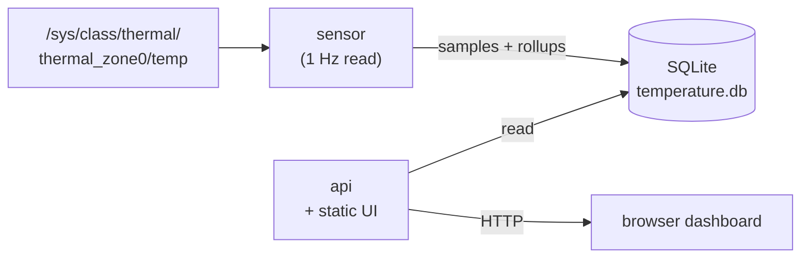

# Temperature Monitor

Lightweight Go stack that samples CPU temperature on Linux, stores it in SQLite, and serves a live chart UI with min/max/mean bands, warning/critical thresholds, and multi-range history.

Designed for always-on boards (e.g. Raspberry PI): a small **sensor** process writes ~1 sample/sec, while an **API** process serves the dashboard and JSON endpoints. Long ranges stay fast via precomputed 1m / 1h / 1d rollups.

## Screenshots

### Light theme


### Dark theme


## Features

- Live temperature chart ([uPlot](https://github.com/leeoniya/uPlot)) with pan/zoom and range presets (10m → 1 month)
- Configurable warning and critical thresholds (°C)
- Stats: current, min, max, mean, time in warning / critical
- SQLite storage with WAL; continuous rollups for efficient long-range queries
- Multiple UI themes (persisted in the browser)
- Cross-compile friendly (`build.sh` for windows/amd64 and linux/arm64)

## Architecture



| Binary       | Role                                                                                   |
| ------------ | -------------------------------------------------------------------------------------- |
| `cmd/sensor` | Reads Linux thermal sysfs, inserts samples, maintains rollups (incl. startup backfill) |
| `cmd/api`    | REST API + serves `index.html` / static assets                                         |

Both processes share the same database file and can run on the same host.

## Requirements

- [Go](https://go.dev/dl/) 1.25+ (see `go.mod`)
- **Sensor:** Linux with `/sys/class/thermal/thermal_zone0/temp` (millidegrees Celsius)
- **API / UI:** any OS that can run the Go binary; browser with network access to the API

## Quick start

### Development (API + UI only)

```bash
export DATABASE_PATH="./temperature.db"
export PORT="5500"
go run ./cmd/api
```

Open [http://localhost:5500](http://localhost:5500). Without a running sensor the UI loads but shows no samples.

Or use the helper script:

```bash
./debug-run.sh   # sets DATABASE_PATH + PORT, runs the API
```

### Sensor (Linux)

```bash
export DATABASE_PATH="/path/to/temperatures.db"
go run ./cmd/sensor
```

On first start with existing raw data, the sensor backfills rollups. Until that finishes, the API falls back to raw samples.

### Cross-compile

```bash
./build.sh
# 1) windows/amd64  → build/windows-amd64/{api,sensor}.exe
# 2) linux/arm64    → build/linux-arm64/{api,sensor}
```

Copy the API binary together with `index.html`, `themes.css`, and `themes.js` (same working directory). The sensor only needs the binary and `DATABASE_PATH`.

## Configuration

| Variable        | Used by     | Example            | Description                                          |
| --------------- | ----------- | ------------------ | ---------------------------------------------------- |
| `DATABASE_PATH` | api, sensor | `./temperature.db` | SQLite file path (parent dirs are created if needed) |
| `PORT`          | api         | `5500`             | HTTP listen port                                     |

Both are **required**, the process exits if unset.
